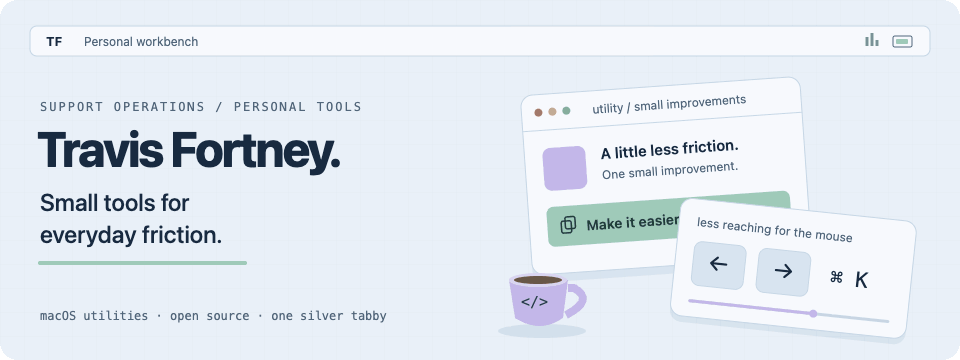

<picture>
  <source media="(max-width: 600px) and (prefers-color-scheme: dark) and (prefers-reduced-motion: reduce)" srcset="assets/workbench-still-mobile-dark.png">
  <source media="(max-width: 600px) and (prefers-reduced-motion: reduce)" srcset="assets/workbench-still-mobile-light.png">
  <source media="(prefers-color-scheme: dark) and (prefers-reduced-motion: reduce)" srcset="assets/workbench-still-dark.png">
  <source media="(prefers-color-scheme: light) and (prefers-reduced-motion: reduce)" srcset="assets/workbench-still-light.png">
  <source media="(max-width: 600px) and (prefers-color-scheme: dark)" srcset="assets/workbench-animated-mobile-dark.gif">
  <source media="(max-width: 600px)" srcset="assets/workbench-animated-mobile-light.gif">
  <source media="(prefers-color-scheme: dark)" srcset="assets/workbench-animated-dark.gif">
  <source media="(prefers-color-scheme: light)" srcset="assets/workbench-animated-light.gif">
  
</picture>

I work in support operations and like building small tools that make repetitive work easier to see, check, or finish.

I like boring checks, readable docs, and small utilities that remove one tiny source of future irritation.

### A little open source

A couple of small contributions to apps I use:

- [Itsycal](https://github.com/sfsam/Itsycal/pull/309)
- [kasetPlus](https://github.com/Yoddikko/kasetPlus/pull/13)
